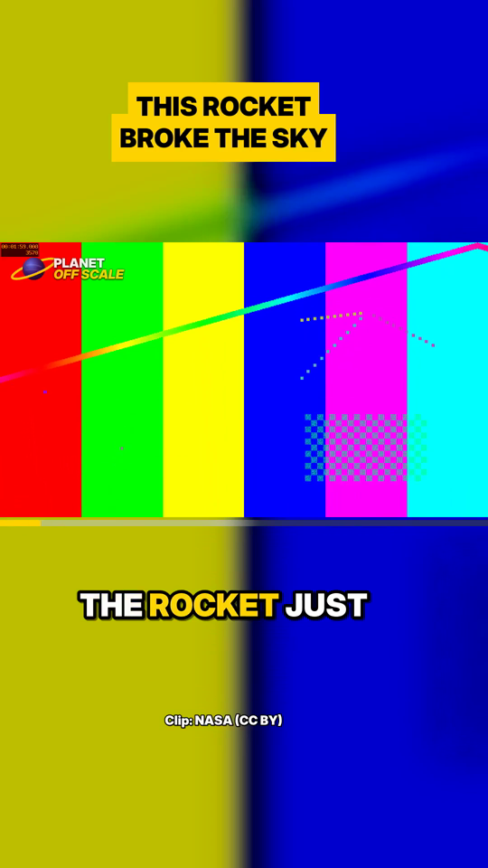

# Format di Planet Off Scale

Un solo stampo, tanti video: ogni format usa lo stesso **brand kit** (`config.json` → `brand`) e lo stesso
template grafico. Per un canale nuovo si cambiano solo brand, ricerche, temi e `assets/` (agent `nuovo-canale`).

## Il template (uguale per tutti i format)
- 9:16 1080x1920, video al centro con sfondo sfocato dello stesso video.
- **Gancio** nel box giallo in alto per i primi 3 s (max 6 parole, maiuscolo).
- **Sottotitoli karaoke** (parola pronunciata nel colore del brand), zona sicura sopra i pulsanti dei social.
- **Logo** in alto a sinistra del video + **barra di avanzamento** gialla sotto il video.
- **Credito** sempre visibile ("Clip: Autore (CC BY)" / "Footage: NASA").
- **Invito a seguire** negli ultimi 2,5 s, tradotto per lingua (`brand.cta`).
- Volume a -14 LUFS, controllato dal Critic.
- Un avatar per lingua (`assets/avatar_<lingua>.png`, `python src/avatar.py`): stessa matrice, etichetta EN/IT/ES.

## Format attivi
| Format | Da dove | Cosa | Quanti | Dove nel codice |
|---|---|---|---|---|
| **Clip** | video YouTube CC BY ≥ 1M views | 12-35 s del momento migliore, scelto da Gemini guardando audio **e fotogrammi** | 8/giorno × lingue | `src/clipper.py` |
| **Top 5** | stesso video CC BY | countdown di 5 momenti con voce narrante | 2/giorno (EN) | `src/top5.py` |
| **Off Scale Facts** | NASA (pubblico dominio) + Pixabay/Pexels | 5 fatti veri "fuori scala" con voce narrante e fonti da controllare | 1/giorno × lingue | `src/fatti.py` |

Un ✅ su Telegram approva **tutte le lingue** del video. Con `pubblica.auto_pubblica_sopra` (es. 75) le clip con
punteggio alto e Critic OK vanno in programma da sole. Ogni lingua esce sui **suoi** canali (`pubblica.canali`).

## Prossimi format (idee, in ordine di facilità)
1. **Scale Check** — "Quanto e' grande davvero?": un oggetto (stella, balena, vulcano) confrontato con cose note,
   barre/sagome disegnate da ffmpeg sopra filmati NASA/Pixabay. Riusa `fatti.py` con un prompt diverso.
2. **Launch Recap** — ogni lancio della settimana in 30 s, dai video NASA/SpaceX con licenza libera.
3. **Animal POV** — "Una giornata da…" con clip CC BY di natura e voce in prima persona.
4. **Then vs Now** — immagini NASA dello stesso luogo in anni diversi (ghiacciai, laghi, citta' di notte).
5. **Long cut 60-90 s** — 3 clip dello stesso video unite: serve per i programmi che pagano solo video > 1 min (verificare i requisiti attuali di ogni piattaforma).

## Regole che non cambiano
- Solo **YouTube CC BY** (licenza ricontrollata via API anche per i link mandati a mano) o **NASA**.
- Nel post: autore, link all'originale, licenza, "edited" (`comune.attribuzione`).
- Niente loghi/scritte di altri canali, niente musica protetta in primo piano.

## Shorts di riferimento

Workflow "Analizza Shorts di riferimento" (`src/riferimenti.py`): incolli i link, Gemini guarda i video e scrive la ricetta (hook, battute, ritmo, testi, voce, finale) in `riferimenti/`, piu' una sintesi unica da applicare al format.

**Ricetta ricavata (4 Shorts di Fra, 28/11), applicata a Off Scale Facts:** 45-55 s, tono cupo e misterioso;
gancio con domanda retorica o "These are the 5 ..." + sfida; testata fissa in alto per tutto il video; per ogni
voce numero grande + nome (`"nome"` nel copione); karaoke 3 parole bianco/giallo; lampo bianco + whoosh a ogni
cambio scena; tappeto dark ambient generato da ffmpeg; finale aperto che rimanda al gancio (loop), niente CTA
(`fatti.cta_finale`, `fatti.musica` in config.json). Prova locale: `python src/anteprima.py facts`.
Prossimo format suggerito dai riferimenti: **Space Sounds** (sonificazioni NASA vere come payoff finale).

## Scaletta (100 video spazio)

`scaletta.json`: 100 idee in ordine (categoria, titolo, gancio, 5 voci, formato `top5` / `storia` / `suoni`).
Off Scale Facts la segue prima dei temi a caso e segna le fatte in `archivio.json -> scaletta_fatte`.
Per provare un formato: workflow "Off Scale Facts" con `formato` (es. `storia`) o `numero` (es. `42`).
